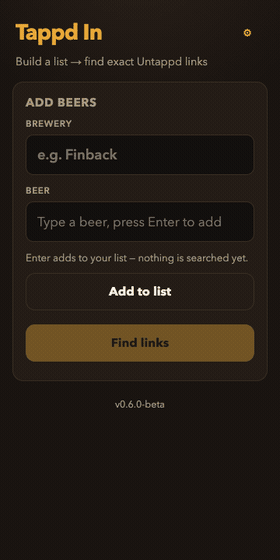

# Tappd In

Type a **brewery** and one or more **beer names**, then find exact Untappd beer links — a mobile-first PWA. Check-ins and social features stay in Untappd.

**Live app:** https://jr00ck.github.io/tappd-in/ *(deploys on version tags)*

**Status for planners:** [`docs/STATUS.md`](docs/STATUS.md) (updated every release)

## Demo



## Features

- **List first, search once** — Enter adds beers without calling Search; **Find links** batches lookups to save credits
- **Exact Untappd URLs only** — never invents a slug; opens `untappd.com/b/{slug}/{id}` (app deep-link on phones when possible)
- **No-match recovery** — pick up to 3 candidates (or numbered variants), Retry one beer, Fix (paste URL), or Search in Untappd
- **Local cache** — confident and picked links are saved on-device; badges show *saved* vs *searched*
- **Brewery chip** — keep typing beers for the same brewery; swipe or × to remove pending rows

## How resolve works

| Path | Notes |
|------|--------|
| Cloudflare Worker + Perplexity Search | Multi-query Search against Untappd beer pages; API key stays on the Worker |
| Manual Fix / Search in Untappd | You confirm the beer; the PWA only stores a valid `/b/…` URL |

## Data & privacy

Brewery history, session list, and URL cache live in `localStorage`. Network calls go to your resolve Worker (and Untappd when you open a link). No photos or OCR.

## Installing

### iOS (Safari)

1. Open https://jr00ck.github.io/tappd-in/ in Safari.
2. Tap Share → **Add to Home Screen**.
3. After an update, **pull down to refresh** in the app.

### Android / Desktop

Install / Add to Home Screen from the browser menu, or use the live URL.

## Local development

```
npm run serve
# http://127.0.0.1:8099  (Cursor Simple Browser is fine)
npm test
```

Service workers need HTTPS or `localhost` / `127.0.0.1`.

While iterating, set `PREVIEW_BUILD` in `app.js` (e.g. `'a3'`) so the footer shows `v0.9.0-beta · a3` off Pages. Clear it before tagging.

## Versioning (pre-1.0)

Stay on `0.x.y-beta` until an explicit **1.0** launch. Do not tag `v1.0.0` (or any `1.x`) until that moment. Increment the beta patch/minor as usual (`0.9.0-beta` → `0.9.1-beta` / `0.10.0-beta`).

## Releasing

GitHub Pages deploys on a pushed `v*` tag (environment must allow tag `v*`).

```
# 1. Bump APP_VERSION + RELEASE_NOTES in app.js, package.json, sw.js CACHE
# 2. Update docs/STATUS.md (keep under 60 lines)
# 3. npm test && npm run changelog   # optional
# 4. Tag + push
git tag -a v0.X.Y-beta -m "v0.X.Y-beta - short description"
git push origin main v0.X.Y-beta
```
